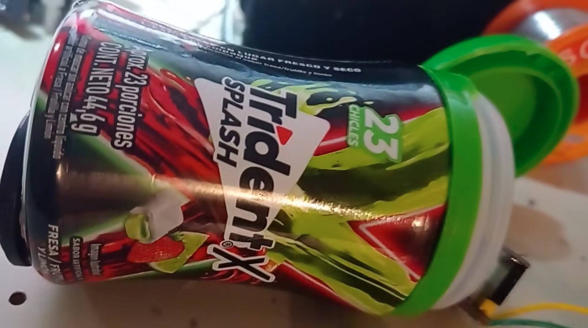
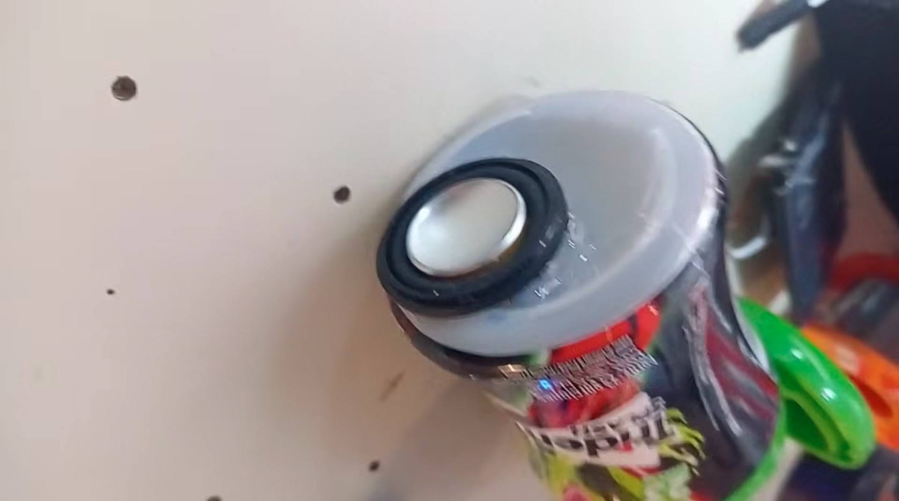
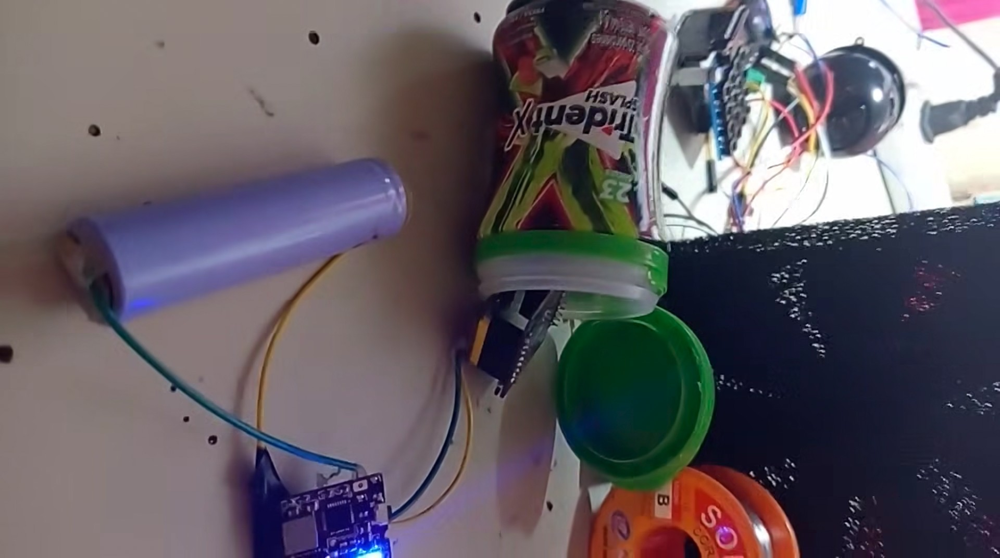

# only80sRadio 📻

  
  
  

## Because 80s music is the only kind of music.

only80sRadio is an ESP32-S2 Mini internet-radio hardware project built around the glorious sounds of the 1980s. It connects over Wi-Fi and streams audio to an I2S-compatible DAC or amplifier. The photos illustrate one possible hardware setup.

**UPDATE** In beta-testing we found out there may be other kinds of music besides 80s music. So, go ahead and tune your only80sRadio to a non-80s radio station if you are one of those people.

## The music comes from SomaFM

This project features **[SomaFM](https://somafm.com/)**, the independent, listener-supported, commercial-free internet radio service. SomaFM's DJs and music directors curate a wide variety of channels for people who love discovering great music.

The prototype is currently configured for **SomaFM Underground 80s**.
The channel is hardcoded into the firmware because, until recently, we
did not know there were other kinds of music besides 80s music. I guess
feel free to change the channel URL in the code if you're one of those
people. Browse the other channels at [SomaFM](https://somafm.com/).

- **Explore the channels:** [SomaFM](https://somafm.com/)
- **Choose a station and listen** on SomaFM's official site.
- **Support the music:** [Donate to SomaFM](https://somafm.com/support/donate.html).
  SomaFM depends on listener support to keep its commercial-free radio
  service on the air.

Please support the people bringing the music to us. Great radio doesn't run on nostalgia alone.

> **Important — SomaFM permissions:** SomaFM's current [Terms of Service](https://somafm.com/contact/tos.html) state that it cannot authorize new third-party SomaFM clients or applications, including noncommercial ones. This project is an independent hardware experiment, not an official or endorsed SomaFM product. Permission and applicable licensing requirements must be clarified before distributing or operating it as a SomaFM client.

## Hardware

- LOLIN/WEMOS ESP32-S2 Mini
- I2S-compatible DAC or amplifier
- Speaker compatible with the selected amplifier
- Suggested power supply: rechargeable 3.7V Li-ion battery with a compatible
  charging/boost module. (In our prototype we use an XL-LBC3.1 module.)

### I2S wiring

| ESP32-S2 Mini GPIO | I2S signal |
| --- | --- |
| GPIO 8 | BCLK |
| GPIO 7 | LRC / WS |
| GPIO 9 | DIN |

Verify your exact board pinout and DAC/amplifier labels before connecting hardware.

## Software

- Arduino IDE or a compatible Arduino build environment
- ESP32 Arduino core
- [ESP8266Audio](https://github.com/earlephilhower/ESP8266Audio) by Earle F. Philhower

## Configuration

The sketch is located at `radio80s_esp32s2/radio80s_esp32s2.ino`.

Before compiling, replace the Wi-Fi placeholders with your local network credentials. **Never commit real Wi-Fi passwords, API keys, or other secrets.**

The current sketch is a basic prototype. It does not yet implement Wi-Fi connection timeouts, automatic reconnection, robust stream recovery, or comprehensive audio-startup error handling.

## Licensing and attribution

The project has not yet been assigned a software license. Until a license is added, no permission is granted to reuse, modify, or redistribute its original code beyond rights provided by applicable law.

SomaFM, its streams, music, artwork, logos, and other materials remain the property of their respective owners and are **not** licensed by this repository. See [SomaFM's Terms of Service](https://somafm.com/contact/tos.html).

Third-party libraries remain subject to their own licenses. This repository is not affiliated with or endorsed by SomaFM.

## The bottom line

**80s forever. Wi-Fi wherever.**

Explore new sounds, support independent radio, and never apologize for your musical standards.
